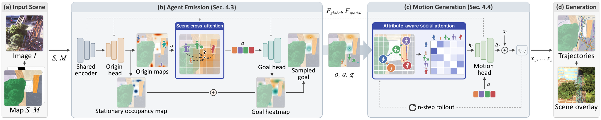

# Attribute-Aware Crowd Generation

**[Project page](https://jungyu0413.github.io/ACG/)** · [Video](https://jungyu0413.github.io/ACG/#video)

[JunGyu Lee](https://jungyu0413.github.io/)\*, Chaemin Hwang\*, [Jisu Shin](https://jsshin.com/), [Seunghyun Shin](https://www.seunghyunshin.com/), [Hae-Gon Jeon](https://scholar.google.com/citations?user=Ei00xroAAAAJ&hl=ko)
(\* equal contribution) · Yonsei University, GIST


Crowds differ from place to place, and behavior differs from person to person. For example, children often walk with their parents around schools, while phone users tend to pay less attention to their surroundings. Capturing this diversity is essential for realistic crowd simulation. However, since datasets that provide both scene maps and pedestrian attribute annotations remain limited, existing crowd generation models do not explicitly learn attribute-dependent patterns. In this paper, we introduce an attribute-aware crowd generation pipeline. To do this, we first construct a crowd trajectory dataset with world-coordinate trajectories, scene semantic maps, and annotations for pedestrian attributes selected based on social studies. Building on this dataset, we propose a framework that models how attribute distributions vary across scenes and how these attributes form agents' motion patterns. Here, we incorporate two attention mechanisms: a scene cross-attention for predicting attributes from agent origins and scene maps, and an attribute-aware social attention for capturing the relative influence of each neighbor based on both agents' attributes and their relative positions. Extensive experiments demonstrate that our model outperforms baselines on public datasets as well as our attribute-annotated dataset. As an application, robot navigation policies trained on our generated crowds achieve lower collision rates while maintaining comparable success rates. To the best of our knowledge, our pipeline is the first attempt to enable attribute-aware crowd generation.



## Status

The paper is under review; the preprint will be linked here when it is available. This repository contains the code, the ETH/UCY and CAT (PANDA) data and the project page (`docs/`, served at https://jungyu0413.github.io/ACG/). In the code and the data folder the CAT dataset appears under its source name, PANDA: the `panda` profile and the `p01` … `p10` folds are the six CAT scenes.

## Code

ACG generates crowd scenarios from a scene map: who appears where, with which attributes, where they go and how
they move. One shared U-Net encoder feeds an emitter (spawn maps + attribute head), a goal head and a velocity head
(the simulator); all are trained jointly in a single stage with a trajectory discriminator. Attributes (life stage,
mobility, constraint, attention) condition the emitter, the goals, the social attention and the motion.

Benchmarks: **ETH/UCY** (5 leave-one-scene-out folds), **SDD** (17 test scenes), **GCS** (corrected test split),
**PANDA** (6 attribute-annotated scenes, 2 time-split folds each). ETH/UCY and PANDA data are included; SDD and GCS
are built from the CrowdES release with one command.

```
acg/        config.py (per-benchmark profiles + published-row overrides), model.py, train.py, generate.py,
            data.py, windows.py, geometry.py, attributes.py, metrics.py (CrowdES metrics, MIT)
scripts/    prepare_data.py, train.py, generate.py, make_table.py, attribute_stats.py
tools/      import_crowdes.py, build_panda_benchmark.py, export_population_prior.py, build_entry_prior.py
data/       scenes, folds and priors (data/README.md)
```

## Setup and usage

```bash
python3.12 -m venv .venv && source .venv/bin/activate
pip install torch==2.11.0 --index-url https://download.pytorch.org/whl/cu128
pip install -r requirements.txt
python tools/import_crowdes.py /path/to/Crowd-Behavior-Generation sdd gcs   # SDD and GCS scenes (optional)

python scripts/prepare_data.py all          # training-split priors (a minute)
python scripts/train.py zara1               # -> weights/acg_zara1_seed0.pth
python scripts/generate.py zara1            # 5 scenarios per test scene + CrowdES metrics
python scripts/make_table.py                # tables next to the CrowdES reference numbers
python scripts/attribute_stats.py panda     # attribute shares and speeds, generated vs GT
```

Folds: `eth hotel univ zara1 zara2 sdd gcs p01A p01B p02A p02B p03A p03B p04A p04B p07A p07B p10A p10B`.
Results: `outputs/metrics/<fold>_<tag>_summary.json` (`__mean__` = the eight metrics) and
`outputs/generated/<fold>/*.pkl.gz` (agent_id, agent_type = attribute code, frame, x, y in image px).
Training takes 15 min (PANDA) to about an hour per fold on one GPU, 24-35 GB; generation is deterministic
(the trial index is the seed).

## Profiles

| | ETH/UCY | SDD | GCS | PANDA |
|---|---|---|---|---|
| tracks / simulator | 25 fps / 5 fps | 30 / 5 | 30 / 5 | 2 / 2 |
| attributes | one code | pedestrian, rider, vehicle | one code | 4 groups, 11-d one-hot |
| width, attribute attention + goal FiLM | 0.5, off | 0.25, on | 0.25, on | 0.25, on |
| training | 80 ep., kinematics term | + latent sigma 1 | + latent sigma 1 | 36 ep., attribute-conditioned discriminator, speed and spacing quantile terms |
| target population | CrowdES scene prior x 0.6 | scene prior x 0.7 | training histogram x 0.1 | training histogram |
| attributes at generation | attribute head | attribute head | training distribution | attribute head, co-moving groups |
| roll-out | scale 1.2, noise 0.1, inertia 0.9 | scale 0.8, noise 0.8, latent, speed heterogeneity 0.3 | scale 1.3, latent | noise 0.6 |
| collision radius | 0.5 m | 20 grid px | 0.5 m | 1 m |

## Method

**Model.** The scene encoder is a U-Net down path over the 320 x 320 scene raster (walkable + 8 classes) plus two
per-agent heatmaps (recent positions, neighbours' positions); a social embedding (relative-position attention over
co-present agents with attribute-dependent tokens and pair bias, plus a GRU over the agent's velocities) is
injected by FiLM at the bottleneck. Three decoders share it: the spawn decoder (13 maps: origins per attribute
value, all origins, standing positions), the goal decoder (destination heatmap, attribute-FiLM) and the velocity
head (next displacement from the local scene feature, social embedding, goal direction, velocity and attribute
embedding, which also modulates the head by FiLM and scales its output). The attribute head predicts the
attributes of an agent starting at a position by cross-attention from the local feature to the bottleneck tokens.

**Training.** Random windows of co-present agents (8 history + 20 future steps), half of them anchored on a
rare-attribute agent where attributes exist. The velocity head is rolled out free-running for 8 steps towards GT
waypoints 4 steps ahead (optionally with a per-agent latent on its input) and scored with the position error,
soft-DTW and an LSGAN discriminator on velocity sequences, plus a speed/acceleration term calibrated once from
gradient norms (ETH/UCY, SDD, GCS) or per-attribute speed and neighbour-distance quantile terms with an
attribute-conditioned discriminator (PANDA). Spawn maps and the attribute head are trained from the empty-scene
encoding, the goal head from the window-start context. The checkpoint with the lowest free-running rollout error
on fixed training windows is kept.

**Generation.** Every 10 s window the emitter tops the scene up to a target population; origins come from the
spawn map and attributes from the attribute head at each origin (or from the training distribution, with origins
from the attribute-value maps); on PANDA co-moving groups share origin, entry time and attributes. Agents without a
goal sample one from the goal head (walkable cells beyond a sampled origin-goal distance, biased towards the
standing-occupancy map) and a lifetime from the training track lengths; the velocity head is rolled out with the
agent's latent, AR(1) noise, inertia, a speed multiplier and a collision-resolution step. Agents leave at the map
border or at the end of their lifetime and get a new goal on arrival. Tracks are Kalman-smoothed and interpolated
to the dataset frame rate. Evaluation uses the eight CrowdES metrics against the dense ground truth; folds with
several test scenes are averaged per scene.

## Published rows

`PAPER_ROWS` in `acg/config.py` holds the settings the published rows selected per test scene (`--row paper` of
`scripts/train.py` and `scripts/generate.py`): ETH/UCY population multiplier, velocity scale, noise and inertia,
the ZARA1 collision radius and lifetime cap, the HOTEL model (width 0.25, attribute terms, latent), and the ZARA
entry/exit prior (origins and destinations from recorded tracks of the same camera). Those rows also converted
metres to grid pixels with the affine block of the homography (ETH, HOTEL, GCS) or with the first scene's scale
(SDD); the profiles use the proper per-scene scale. GCS is evaluated on the corrected test split (the released
test half re-indexed from frame 0) against the released CrowdES checkpoint re-run on it.

## Third-party

`acg/metrics.py` and the data conventions come from Crowd-Behavior-Generation (CrowdES, Bae et al., CVPR 2025, MIT).
