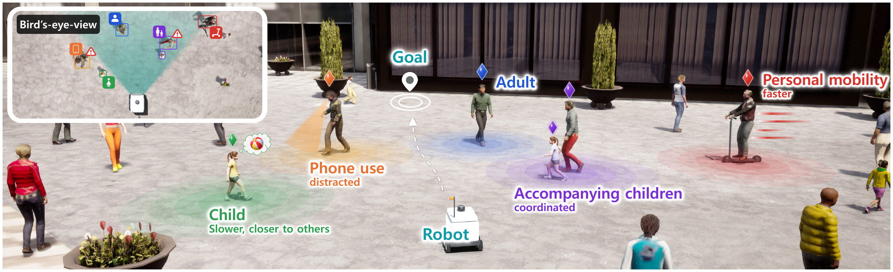

<h2 align="center">Attribute-Aware Crowd Generation</h2>

<p align="center">
  <a href="https://jungyu0413.github.io/"><strong>JunGyu Lee</strong></a><sup>1,*</sup>
  &nbsp;·&nbsp;
  <a href="https://chaemin-hwang.github.io/"><strong>Chaemin Hwang</strong></a><sup>1,*</sup>
  &nbsp;·&nbsp;
  <a href="https://jsshin.com/"><strong>Jisu Shin</strong></a><sup>2</sup>
  &nbsp;·&nbsp;
  <a href="https://www.seunghyunshin.com/"><strong>Seunghyun Shin</strong></a><sup>2</sup>
  &nbsp;·&nbsp;
  <a href="https://scholar.google.com/citations?user=Ei00xroAAAAJ&hl=ko"><strong>Hae-Gon Jeon</strong></a><sup>1</sup>
  <br>
  <sup>1</sup>Yonsei University &nbsp;&nbsp; <sup>2</sup>GIST &nbsp;&nbsp; <sup>*</sup>Equal contribution
  <br>
  Under review · 2026
</p>

<p align="center">
  <a href="https://jungyu0413.github.io/ACG/"><strong><code>Project Page</code></strong></a>
  <a href="https://jungyu0413.github.io/ACG/#video"><strong><code>Video</code></strong></a>
  <a href="#-citation"><strong><code>Citation</code></strong></a>
</p>

<div align="center">
  <br>
  <br><em>People with different attributes move and interact in different ways. ACG is the first attempt to simulate pedestrians' motions and interactions according to their attributes such as age, accompanying children, and phone use.</em>
</div>

<br>

## 📝 Abstract

Crowds differ from place to place, and behavior differs from person to person. For example, children often walk
with their parents around schools, while phone users tend to pay less attention to their surroundings. Capturing
this diversity is essential for realistic crowd simulation. However, since datasets that provide both scene maps and
pedestrian attribute annotations remain limited, existing crowd generation models do not explicitly learn
attribute-dependent patterns. In this paper, we introduce an **attribute-aware crowd generation pipeline**. To do
this, we first construct a crowd trajectory dataset with world-coordinate trajectories, scene semantic maps, and
annotations for pedestrian attributes selected based on social studies. Building on this dataset, we propose a
framework that models how attribute distributions vary across scenes and how these attributes form agents' motion
patterns. Here, we incorporate two attention mechanisms: a scene cross-attention for predicting attributes from
agent origins and scene maps, and an attribute-aware social attention for capturing the relative influence of each
neighbor based on both agents' attributes and their relative positions. Extensive experiments demonstrate that our
model outperforms baselines on public datasets as well as our attribute-annotated dataset. As an application, robot
navigation policies trained on our generated crowds achieve lower collision rates while maintaining comparable
success rates. To the best of our knowledge, our pipeline is the first attempt to enable attribute-aware crowd
generation.

<br>

## 🧭 Method

<div align="center">
  
  <br><em>A shared U-Net encoder provides scene features to both agent emission and crowd motion. Scene cross-attention predicts attribute distributions from agent origins and scene context. Attribute-aware social attention models interactions based on attribute pairs and relative positions. The sampled attributes condition goal generation and displacement prediction.</em>
</div>

<br>

| Paper | Code |
|:--|:--|
| Shared scene encoder θ<sub>enc</sub> with the social embedding injected by FiLM (Sec. 4.2, Eq. 1) | [`acg/model.py`](acg/model.py) `SceneEncoder`, `SocialEncoder` |
| Origin head: origin, attribute-specific origin and stationary-occupancy maps (Sec. 4.3, Eq. 3–4) | [`acg/model.py`](acg/model.py) `MapDecoder` (spawn decoder) |
| Scene cross-attention, attribute distributions at an origin (Eq. 5) | [`acg/model.py`](acg/model.py) `AttributeHead` |
| Goal head, FiLM-conditioned on the attribute embedding (Eq. 6) | [`acg/model.py`](acg/model.py) `MapDecoder` (goal decoder) |
| Attribute-aware social attention with the bias ϕ<sub>rel</sub> + ϕ<sub>pair</sub> (Sec. 4.4, Eq. 7–8) | [`acg/model.py`](acg/model.py) `SocialEncoder` |
| Displacement prediction scaled by the attribute embedding (Eq. 9) | [`acg/model.py`](acg/model.py) `VelocityHead` |
| Training objectives L<sub>ce</sub>, L<sub>traj</sub>, L<sub>beh</sub> (Sec. 4.5, Eq. 10–11, App. D) | [`acg/train.py`](acg/train.py) `Trainer`, `Discriminator`, `soft_dtw`, `speed_quantile_loss`, `neighbour_quantile_loss` |
| Generation: emission, roll-out, collision resolution, lifetimes (Sec. 4.5, App. C) | [`acg/generate.py`](acg/generate.py) `Generator` |
| Attribute codes and one-hot groups (Sec. 3.2) | [`acg/attributes.py`](acg/attributes.py) |
| Scene-level and agent-level metrics (Sec. 5.1) | [`acg/metrics.py`](acg/metrics.py) |

<details>
<summary><b>Implementation notes</b> (click to expand)</summary>

**Model.** The scene encoder is a U-Net down path over the 320 × 320 scene raster (walkable + 8 classes) plus two
per-agent heatmaps (recent positions, neighbours' positions); a social embedding (relative-position attention over
co-present agents with attribute-dependent tokens and pair bias, plus a GRU over the agent's velocities) is injected
by FiLM at the bottleneck. Three decoders share it: the spawn decoder (13 maps: origins per attribute value, all
origins, standing positions), the goal decoder (destination heatmap, attribute-FiLM) and the velocity head (next
displacement from the local scene feature, social embedding, goal direction, velocity and attribute embedding, which
also modulates the head by FiLM and scales its output). The attribute head predicts the attributes of an agent
starting at a position by cross-attention from the local feature to the bottleneck tokens.

**Training.** Random windows of co-present agents (8 history + 20 future steps), half of them anchored on a
rare-attribute agent where attributes exist. The velocity head is rolled out free-running for 8 steps towards GT
waypoints 4 steps ahead (optionally with a per-agent latent on its input) and scored with the position error,
soft-DTW and an LSGAN discriminator on velocity sequences, plus a speed/acceleration term calibrated once from
gradient norms (ETH/UCY, SDD, GCS) or per-attribute speed and neighbour-distance quantile terms with an
attribute-conditioned discriminator (CAT). Spawn maps and the attribute head are trained from the empty-scene
encoding, the goal head from the window-start context. The checkpoint with the lowest free-running rollout error on
fixed training windows is kept.

**Generation.** Every 10 s window the emitter tops the scene up to a target population; origins come from the spawn
map and attributes from the attribute head at each origin (or from the training distribution, with origins from the
attribute-value maps); on CAT co-moving groups share origin, entry time and attributes. Agents without a goal sample
one from the goal head (walkable cells beyond a sampled origin-goal distance, biased towards the standing-occupancy
map) and a lifetime from the training track lengths; the velocity head is rolled out with the agent's latent, AR(1)
noise, inertia, a speed multiplier and a collision-resolution step. Agents leave at the map border or at the end of
their lifetime and get a new goal on arrival. Tracks are Kalman-smoothed and interpolated to the dataset frame rate.

</details>

<br>

## 📊 Results

**Crowd generation.** Scene-level realism (density, frequency, coverage, population) and agent-level similarity
(kinematics, DTW, diversity, collision rate) following CrowdES; lower is better except Div. CAT uses two-fold temporal
cross-validation on six scenes, ETH/UCY is averaged over five scenes, † marks reimplemented baselines, and GCS uses a
common test split built for this study (Tables 2–3). **Bold**: best, <u>underline</u>: second best.

| Method | Dens. | Freq. | Cov. | Pop. | Kin. | DTW | Div. | Col. (%) |
|:--|:-:|:-:|:-:|:-:|:-:|:-:|:-:|:-:|
| *CAT (ours), 12 evaluations* | | | | | | | | |
| SE-ORCA | 0.553 | 0.482 | 0.359 | 0.167 | <u>0.400</u> | 49.27 | 0.250 | **0.001** |
| VAE | 0.486 | 0.092 | 0.074 | 0.160 | 0.607 | 37.68 | <u>0.253</u> | 0.024 |
| TRACE | <u>0.422</u> | 0.124 | 0.058 | <u>0.148</u> | 0.775 | 44.00 | 0.229 | <u>0.017</u> |
| CrowdES | <u>0.422</u> | <u>0.090</u> | **0.040** | 0.154 | 0.607 | <u>37.48</u> | 0.251 | 0.025 |
| **ACG (ours)** | **0.327** | **0.064** | <u>0.057</u> | **0.117** | **0.343** | **24.62** | **0.340** | **0.001** |
| *ETH/UCY, five-scene average* | | | | | | | | |
| SE-ORCA | 0.130 | 0.086 | 0.086 | 0.670 | 0.495 | 1.310 | 0.243 | <u>0.025</u> |
| VAE | 0.132 | 0.086 | 0.086 | 0.670 | 0.690 | 1.676 | 0.274 | 1.737 |
| TRACE† | 0.089 | <u>0.053</u> | <u>0.053</u> | 0.315 | 1.095 | 0.988 | **0.310** | 1.221 |
| CrowdES | <u>0.081</u> | <u>0.053</u> | <u>0.053</u> | <u>0.283</u> | **0.337** | <u>0.933</u> | 0.289 | 0.916 |
| **ACG (ours)** | **0.057** | **0.031** | **0.031** | **0.191** | <u>0.418</u> | **0.912** | <u>0.299</u> | **0.005** |
| *SDD* | | | | | | | | |
| SE-ORCA | 0.058 | 0.047 | <u>0.044</u> | 0.540 | 0.893 | 6.645 | 0.377 | <u>0.048</u> |
| VAE | 0.052 | 0.052 | 0.047 | 0.678 | 1.078 | 7.881 | **0.387** | 2.470 |
| TRACE† | 0.044 | **0.031** | **0.030** | **0.430** | 0.909 | **5.519** | 0.346 | 0.161 |
| CrowdES | **0.038** | <u>0.033</u> | **0.030** | 0.463 | <u>0.650</u> | 6.352 | 0.354 | 0.411 |
| **ACG (ours)** | <u>0.040</u> | **0.031** | **0.030** | <u>0.459</u> | **0.631** | <u>5.845</u> | <u>0.380</u> | **0.000** |
| *GCS†* | | | | | | | | |
| SE-ORCA | 1.099 | 0.195 | 0.195 | 2.539 | 1.088 | 3.212 | 0.244 | **0.002** |
| VAE | 0.978 | 0.376 | 0.376 | 2.259 | 1.040 | 3.836 | 0.319 | 10.624 |
| TRACE | 0.686 | 0.341 | 0.341 | 1.584 | <u>0.401</u> | **2.483** | **0.334** | 3.492 |
| CrowdES | <u>0.332</u> | <u>0.121</u> | <u>0.121</u> | <u>0.768</u> | 1.192 | 5.064 | 0.316 | 10.279 |
| **ACG (ours)** | **0.328** | **0.115** | **0.115** | **0.757** | **0.393** | <u>2.825</u> | <u>0.320</u> | <u>2.672</u> |

**Attribute fidelity on CAT.** Agent proportions and mean speeds pooled over the twelve evaluations (Table 5).
**Bold**: smaller absolute error against the real crowd.

| Attribute | Real | CrowdES | ACG (ours) | Real | CrowdES | ACG (ours) |
|:--|:-:|:-:|:-:|:-:|:-:|:-:|
| | *proportion* | | | *mean speed (m/s)* | | |
| Adult | 0.938 | 0.972 | **0.942** | 0.88 | 0.98 | **0.94** |
| Child | 0.154 | 0.097 | **0.133** | 0.58 | 0.82 | **0.79** |
| Personal mobility | 0.045 | 0.026 | **0.050** | 2.23 | 0.39 | **2.06** |
| Dependent mobility | 0.017 | 0.002 | **0.007** | 0.69 | 0.21 | **0.87** |
| Accompanying children | 0.099 | 0.022 | **0.057** | 0.62 | 0.90 | **0.82** |
| Phone use | 0.119 | 0.092 | **0.125** | 0.83 | 1.22 | **1.15** |

**Robot navigation.** SARL, RGL, LSTM-RL and CrowdNav++ trained on CrowdES or ACG crowds and cross-tested on both
generators' crowds in unseen CAT scenes (Table 7). **Bold**: the better value within each policy.

| Policy | Training crowd | Success ↑ | Collision ↓ | Success ↑ | Collision ↓ |
|:--|:--|:-:|:-:|:-:|:-:|
| | | *on CrowdES crowds* | | *on ACG crowds* | |
| SARL | CrowdES | **0.964** | 0.022 | 0.852 | 0.120 |
| | **ACG (ours)** | 0.956 | **0.018** | **0.892** | **0.074** |
| RGL | CrowdES | 0.938 | 0.051 | 0.852 | 0.127 |
| | **ACG (ours)** | **0.966** | **0.021** | **0.908** | **0.074** |
| LSTM-RL | CrowdES | 0.967 | 0.024 | 0.865 | 0.113 |
| | **ACG (ours)** | **0.973** | **0.017** | **0.890** | **0.092** |
| CrowdNav++ | CrowdES | **0.611** | 0.090 | **0.491** | 0.245 |
| | **ACG (ours)** | 0.553 | **0.064** | 0.485 | **0.157** |

**Runtime.** 1.81 ms per agent-step, against 1.97 ms for ORCA, 2.20 ms for CrowdES, 24.20 ms for VAE and 96.9 ms for
TRACE (Table 4). **User study.** 50 participants, 900 responses over 18 video pairs: ACG is preferred for realism
(83.3%), scene–attribute consistency (88.0%), attribute–motion consistency (86.0%) and navigation safety (91.8%)
(Table 8).

<br>

## 🛠️ Setup

**Environment.** Python 3.12 and PyTorch 2.11; install PyTorch for your CUDA version first.

```bash
git clone https://github.com/jungyu0413/ACG.git && cd ACG
python3.12 -m venv .venv && source .venv/bin/activate
pip install torch==2.11.0 --index-url https://download.pytorch.org/whl/cu128
pip install -r requirements.txt
```

**Datasets.** ETH/UCY (five leave-one-scene-out folds) and CAT are shipped in [`data/`](data/README.md). In the
code and the data folder CAT appears under its source name, PANDA: the `panda` profile and the `p01` … `p10` folds
are the six CAT scenes, each split in time into two folds (`A`: train on the first half, `B`: the reverse). SDD
(17 test scenes) and GCS (corrected test split) are built from the
[CrowdES](https://github.com/InhwanBae/Crowd-Behavior-Generation) release:

```bash
python tools/import_crowdes.py /path/to/Crowd-Behavior-Generation sdd gcs
python scripts/prepare_data.py all          # training-split priors (about a minute)
```

Folds: `eth hotel univ zara1 zara2 sdd gcs p01A p01B p02A p02B p03A p03B p04A p04B p07A p07B p10A p10B`.

<br>

## 🔥 Training

```bash
python scripts/train.py zara1               # -> weights/acg_zara1_seed0.pth
python scripts/train.py p04A --row paper    # settings of the published row for this fold
```

Training takes 15 minutes (CAT) to about an hour (ETH/UCY, SDD, GCS) per fold on one GPU with 24–35 GB of memory.
Per-benchmark profiles live in [`acg/config.py`](acg/config.py):

| | ETH/UCY | SDD | GCS | CAT (PANDA) |
|:--|:--|:--|:--|:--|
| tracks / simulator | 25 fps / 5 fps | 30 / 5 | 30 / 5 | 2 / 2 |
| attributes | one code | pedestrian, rider, vehicle | one code | 4 groups, 11-d one-hot |
| width, attribute attention + goal FiLM | 0.5, off | 0.25, on | 0.25, on | 0.25, on |
| training | 80 ep., kinematics term | + latent σ = 1 | + latent σ = 1 | 36 ep., attribute-conditioned discriminator, speed and spacing quantile terms |
| target population | CrowdES scene prior × 0.6 | scene prior × 0.7 | training histogram × 0.1 | training histogram |
| attributes at generation | attribute head | attribute head | training distribution | attribute head, co-moving groups |
| roll-out | scale 1.2, noise 0.1, inertia 0.9 | scale 0.8, noise 0.8, latent, speed heterogeneity 0.3 | scale 1.3, latent | noise 0.6 |
| collision radius | 0.5 m | 20 grid px | 0.5 m | 1 m |

<br>

## 🚀 Generation and Evaluation

```bash
python scripts/generate.py zara1            # 5 scenarios per test scene + the eight CrowdES metrics
python scripts/make_table.py                # tables next to the CrowdES reference numbers
python scripts/attribute_stats.py panda     # attribute shares and speeds, generated vs. real
```

Generation is deterministic (the trial index is the seed). Results land in
`outputs/metrics/<fold>_<tag>_summary.json` (`__mean__` holds the eight metrics) and
`outputs/generated/<fold>/*.pkl.gz` (`agent_id`, `agent_type` = attribute code, `frame`, `x`, `y` in image pixels).

`PAPER_ROWS` in [`acg/config.py`](acg/config.py) holds the settings the published rows selected per test scene
(`--row paper` of `scripts/train.py` and `scripts/generate.py`): the ETH/UCY population multiplier, velocity scale,
noise and inertia, the ZARA1 collision radius and lifetime cap, the HOTEL model (width 0.25, attribute terms, latent)
and the ZARA entry/exit prior. Those rows converted metres to grid pixels with the affine block of the homography
(ETH, HOTEL, GCS) or with the first scene's scale (SDD); the profiles use the proper per-scene scale. GCS is
evaluated on the corrected test split (the released test half re-indexed from frame 0) against the released CrowdES
checkpoint re-run on it.

**Pretrained weights** will be released on the [release page](https://github.com/jungyu0413/ACG/releases).

<br>

## 🗂️ Code Structure

<details>
<summary>Click to expand</summary>

```
ACG/
├── acg/
│   ├── model.py           # shared encoder, spawn/goal decoders, attribute head, social attention, velocity head
│   ├── train.py           # joint single-stage training, discriminator, soft-DTW and quantile terms
│   ├── generate.py        # emission, roll-out, collision resolution, smoothing
│   ├── config.py          # per-benchmark profiles and published-row overrides
│   ├── data.py            # folds, scenes, training-split priors
│   ├── windows.py         # training windows of co-present agents
│   ├── geometry.py        # homographies, scene rasters, heatmaps
│   ├── attributes.py      # attribute codes and one-hot groups
│   └── metrics.py         # CrowdES metrics (MIT)
├── scripts/               # prepare_data → train → generate → make_table, attribute_stats
├── tools/                 # import_crowdes, build_panda_benchmark, export_population_prior, build_entry_prior
├── data/                  # scenes, folds and priors (data/README.md)
├── weights/               # checkpoints (weights/README.md)
├── assets/                # README figures
└── docs/                  # project page
```

</details>

<br>

## 📖 Citation

If you find this code useful, please cite our paper. The entry will be updated when the preprint is available.

```bibtex
@article{lee2026acg,
  title   = {Attribute-Aware Crowd Generation},
  author  = {Lee, JunGyu and Hwang, Chaemin and Shin, Jisu and Shin, Seunghyun and Jeon, Hae-Gon},
  journal = {Under review},
  year    = {2026}
}
```

<br>

## 📄 License

This code is released under the [MIT](LICENSE) license, matching
[CrowdES](https://github.com/InhwanBae/Crowd-Behavior-Generation), whose metrics and data conventions it reuses.

## 🙏 Acknowledgements

`acg/metrics.py` and the data conventions come from [CrowdES](https://github.com/InhwanBae/Crowd-Behavior-Generation).
CAT is built from [PANDA](https://gigavision.cn/) video sequences obtained through the GigaMOT Challenge, with ground
reference points from Google Earth imagery; generated crowds on the project page are rendered in
[CARLA](https://carla.org/). We thank the authors for releasing their code and data.
